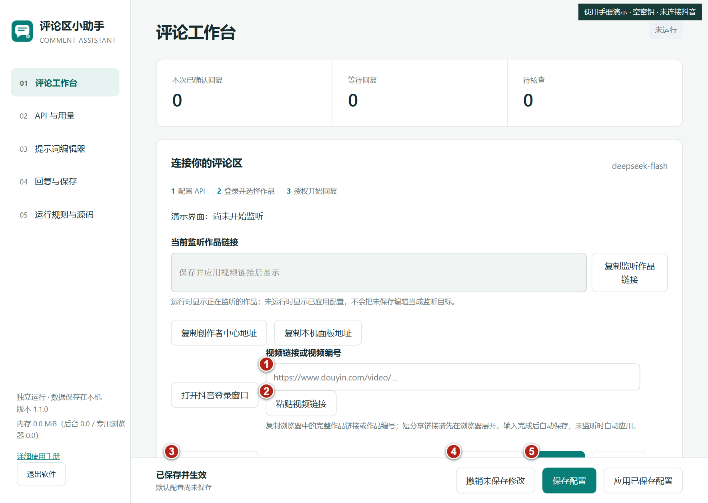

# 评论区小助手

独立 Windows 抖音评论辅助工具。使用自己的模型 API 和抖音账号，核查上下文后回复评论。默认提示词是通用评论助手，不附带任何个人密钥、账号或评论数据。



## 运行环境

| 使用方式 | 要求 |
| --- | --- |
| 已打包程序 | Windows 10/11 64 位、Microsoft Edge、网络连接；无需安装 Python |
| 源码运行 | Windows、Python 3.12+、Edge、requirements.txt 依赖；本机测试使用 Python 3.14 |
| 文档阅读 | WPS Office 或 Microsoft Word 打开 DOCX；浏览器打开 HTML |

仅绑定本机 127.0.0.1，默认端口 8896。没有 Linux/macOS 桌面兼容保证。程序未签名，Windows 可能提示未知发布者。模型调用可能计费；需要自行取得厂商 API Key。内存占用含专用 Edge 进程，实际取决于页面和评论量，界面会显示估算工作集。

## 下载

在 [Releases](https://github.com/pyp551/comment-assistant/releases) 下载分享包，解压后运行程序；包内含图解教程。GitHub 的 Source code 下载只包含源码，不能直接双击运行。本仓库及发行包可公开访问。

## 首次使用

1. 解压发行包，打开程序。在 API 与用量选择厂商、模型，填写自己的 Key。
2. 停止输入约 0.8 秒后自动保存；未监听时自动应用。检查底部状态，验证失败会显示未保存原因。正在监听时不切换当前配置。
3. 首页填写完整作品链接或作品编号，同样自动保存。提示词、语气等其他设置仍需保存和应用。
4. 打开专用抖音窗口，手动登录并选择作品。首次启动尝试从已登录页面的本人账号响应识别身份；读取失败可重试或明确确认一条本人既有评论。不会发送测试评论来识别身份。
5. 勾选作品授权，开始监听。验证码或平台限制需本人处理。
6. 关闭界面后后台继续运行，右下角系统托盘保留图标（可能在“隐藏的图标”内）。右键可打开界面，或选择“退出软件（等待发送收尾）”；网页左下角也可退出。不要运行两份程序回复同一作品。

## 功能和边界

- DeepSeek 默认；千问、Kimi、OpenAI 兼容接口，以及 Claude/Gemini 原生协议。预设模型只是候选，以厂商列表与连接测试为准。
- 官方 DeepSeek 支持查询余额；其他厂商未接入余额。用量是本软件记录的调用与 tokens，不是账户总账单。
- 提示词、格式约定、迟回复和重写规则可查看修改；程序校验和去重保护仍执行。
- 日志分色，详情刷新保持展开。右侧展示原评论、处理结果和本机已确认回复。
- 历史检查页正文超时时，主页面健康且目标/会话不变才自动重建独立页；前三次等待30秒，之后300秒。验证码、登录过期、平台限制仍停止。
- `unclear` 仍表示模型不明确理解而主动跳过，本版没有改变该策略。历史定位失败不表示评论不存在；图片不保证能理解。
- 发送结果未知不自动重发。已确认与人工已回复记录用于去重，不要删库解决故障。

## 开发和打包

```powershell
py -3.12 -m venv .venv
.\.venv\Scripts\Activate.ps1
python -m pip install -r requirements.txt
python launcher.py
python -m unittest discover -s tests -q
python build.py
```

打包输出 `dist/CommentAssistant.exe`。运行程序使用已安装 Edge，无需下载 Playwright Chromium。测试应在隔离数据目录执行；不要连接正在使用的服务或用真实密钥测试发评论。

```powershell
$env:COMMENT_WORKBENCH_DATA = "$PWD\qa-data"
$env:COMMENT_WORKBENCH_PORT = "18999"
python launcher.py
```

测试路由使用独立端口18998，确保未被占用。`COMMENT_WORKBENCH_DATA` 指定数据目录后，界面迁移被禁用，需修改启动环境。恢复默认时清除环境变量再启动。

## 数据与隐私

默认 `%LOCALAPPDATA%\CommentWorkbench`。自定义位置见界面。settings.json 存配置；选择记住的 Key 用当前 Windows 用户 DPAPI 加密。不记住的 Key 只保留本次进程。comments.sqlite3 保存评论、发送及去重，usage.sqlite3 保存调用统计。浏览器目录保存登录资料。不要上传这些文件。

迁移需新空目录，停止收尾、预约、完全退出后重开。原目录保留，新浏览器目录需重新登录。备份应在完全退出后复制实际数据目录及默认目录的位置指针。

## 文档和项目结构

- [图解教程](docs/评论区小助手新版图解教程.docx)
- [架构和维护](docs/DEVELOPMENT.md)
- [更新记录](CHANGELOG.md)
- app/server.py：页面核查、调度和本机接口
- app/core.py、reconcile.py：数据库、去重和讨论串覆盖
- app/providers.py、settings.py、storage.py：模型、设置及目录迁移
- app/web/index.html：前端；tests：离线回归

## 验证状态

124 项离线测试通过；演示浏览器验证了详情展开保持和原评论/回复展示。截图使用空密钥和教学数据，不含真实评论。未对所有厂商做真实付费调用，也不保证抖音未来页面或接口不变化。新账号自动识别仅支持代码明确识别的本人接口，失败不会猜测身份。

## 权利说明

本仓库公开可见，但尚未指定开源许可证。依赖遵循各自许可证；公开可见不等于获得任意再分发或商业使用授权。只管理你有权操作的作品，并遵守平台及模型服务条款。
